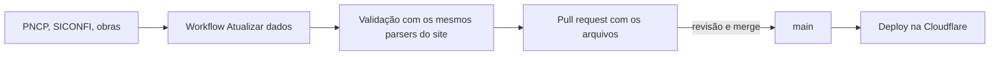

<p align="center">
  
</p>

<h1 align="center">Visse?</h1>

<p align="center">
  <strong>Veja e cobre o que acontece na sua cidade.</strong><br>
  Ferramentas abertas para o cidadão do Nordeste fiscalizar o dinheiro público.
</p>

<p align="center">
  <a href="https://civisbr-visse.anti-heroi.workers.dev">civisbr-visse.anti-heroi.workers.dev</a>
</p>

---

O Visse? é um projeto do **CivisBR**. Ele junta dados abertos do governo, explica em linguagem simples e mostra o caminho para denunciar, tudo sem cadastro e sem coletar dados pessoais.

## O que tem

| Ferramenta | O que faz | Fonte dos dados |
| --- | --- | --- |
| **Entenda os gastos** | Quanto cada cidade gastou com saúde, educação e pessoal, explicado em palavras simples. Mapa do Nordeste com uma bandeira em cada município acima dos limites da Lei de Responsabilidade Fiscal. Ano fechado e ano em andamento (parcial). | SICONFI, Tesouro Nacional |
| **Contratos suspeitos** | Aponta contratos de prefeituras com sinais de alerta, como empresa aberta há menos de 6 meses ou aditivos que elevam o valor em mais de 25% sobre o contrato original. É um indício estatístico, nunca uma acusação. | PNCP e BrasilAPI (CNPJ) |
| **Obras paradas** | Lista obras públicas paralisadas, agrupadas por estado. | ObrasGov, governo federal |
| **Faça sua denúncia** | Formulário que gera a representação em PDF no próprio navegador e mostra os canais do Ministério Público de cada estado (telefone, e-mail, formulário). | Sites oficiais dos MPs |

## Como os dados chegam ao site

Os dados ficam em `public/data` e são atualizados por um workflow do GitHub Actions (`.github/workflows/dados.yml`), toda segunda-feira ou sob demanda.



- Nada é publicado sem passar por validação e por revisão humana no PR.
- Um segundo workflow confere todo mês se os endereços dos Ministérios Públicos continuam no ar.
- Os números são informados pelas próprias prefeituras e podem ser retificados. O site mostra a data da coleta e avisa quando os dados estão velhos.

## Privacidade

- O documento de denúncia é montado no navegador. Nome e cidade não saem do aparelho.
- Não há login, cookie de rastreamento nem anúncio.
- O mapa é desenhado com malhas do IBGE servidas pelo próprio site, sem mapas de terceiros.
- Alertas sobre pessoas físicas e CPFs nunca são publicados.

## Tecnologia

TanStack Start (React 19), TypeScript, Tailwind CSS v4, shadcn/ui, Vitest. Servido como Cloudflare Worker com arquivos estáticos. Gerenciador de pacotes: [Bun](https://bun.sh).

## Rodando localmente

```bash
bun install
bun run dev        # http://localhost:8080
```

Outros comandos:

```bash
bun run test       # testes
bunx tsc --noEmit  # checagem de tipos
bun run build      # build de produção
```

Para gerar os dados à mão (leva de dezenas de minutos, por causa dos limites das APIs):

```bash
bun scripts/dados/gastos.ts            # último ano fechado
bun scripts/dados/gastos.ts corrente   # ano em andamento
bun scripts/dados/red-flags.ts         # contratos (DIAS=30 por padrão)
bun scripts/dados/obras.ts
bun scripts/dados/validar.ts gastos    # valida antes de publicar
```

## Estrutura

```text
src/routes/        páginas e rotas do site
src/components/    mapa, seletor de cidade, lista por estado, botão de denúncia
src/lib/           leitura e validação dos dados, textos, contatos dos MPs
scripts/dados/     coleta e validação dos dados abertos
public/data/       arquivos JSON publicados
.github/workflows/ CI, atualização de dados, conferência dos contatos, deploy
```

## Deploy

Cada push na `main` roda typecheck, testes e build, e publica na Cloudflare Workers (`.github/workflows/deploy.yml`). O workflow usa os secrets `CLOUDFLARE_API_TOKEN` e `CLOUDFLARE_ACCOUNT_ID` do ambiente `producao`.

## Contribuindo

Achou um alerta errado ou um contato desatualizado? [Abra uma issue](https://github.com/civisbr/visse/issues/new). Mudanças no código passam por testes e revisão antes de entrar.

## Aviso

Os indicadores são automáticos, baseados em dados abertos, e servem para priorizar a conferência nas fontes oficiais. Não indicam irregularidade nem culpa, e o Visse? não substitui a análise de um Tribunal de Contas ou do Ministério Público.
